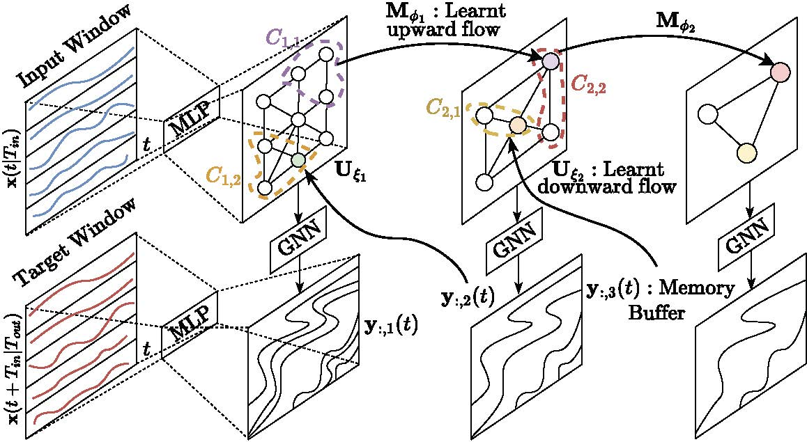
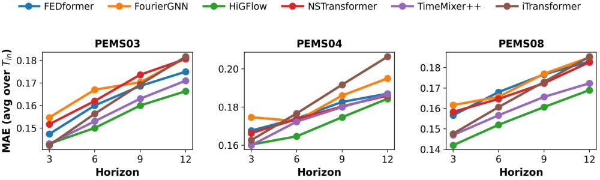

# Overview of Code Repository

  

  

This is a repository for the paper *Improving Hierarchical Graph Neural Network Forecasters through Expressive Memory Enhancement*, which proposes the HiGFlow model, a Hierarchical Graph Neural Network (GNN) that uses a memory buffer to retain learnt global trends.  

## Environment Set up 

To run HiGFlow, we use `Python 3.10.12`. Environment packages can be installed by running `pip install -r requirements.txt`. Note that in our implementations, we use the CUDA-enabled versions of `torch-scatter` and `torch-sparse`. 

## Run HiGFlow over the PEMS datasets

To run HiGFlow over PEMS, where we use the known ground truth graph from torch-spatiotemporal, use the following call signature:

`python main.py --train --dataset PEMS04 --model HiGFlowGraph --gpu 0 --epoch 50`

The HiGFlowGraph implementation bypasses the graph embedding discussed in Section 3. 

## Run HiGFlow over Electricity

We provide the Electricity dataset in our repository. The call signature for the HiGFlow implementation that uses a timeseries-to-graph embedding is: 

`python main.py --train --dataset PEMS04 --model HiGFlow --gpu 0 --epoch 50`

## Explanation of .py Files

- `main.py`: Entry point invoked by the user; runs all experiments.
- `handler.py`: Executes the training loop; called by `train.py`.
- `train.py`: Manages model training across iterations; calls `handler.py`.
- `cluster_utils.py`: Implements Graclus clustering and related HGNN algorithms.
- `networks.py`: Defines lifting and embedding transitions, the memory-buffer GNN, and HiGFlow.
- `networks_graph_known.py`: Implements HiGFlowGraph without graph embeddings.
- `mutils.py`: Miscellaneous utility functions.

